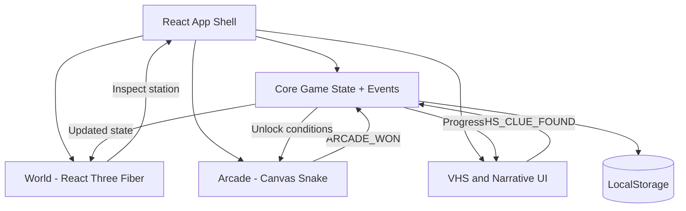

# Game foundation — Technical Design (INITIAL DRAFT)

## Modular architecture

## Team boundaries

- World (`src/world`): scene, movement, camera, interactables, visual reactions to immutable state.
- Arcade (`src/arcade`): independent Snake engine and Canvas UI, emits typed completion event.
- Memories/UI (`src/memories`, `src/ui`): tape transport, story, menus, accessibility, and persistence integration.
- Core (`src/core`): shared types and pure reducer; approved jointly by all three contributors.

## Event contract

`src/core/contracts.ts` is the canonical implementation. Events are discriminated unions including `TAPE_COLLECTED`, `VHS_CLUE_FOUND`, `ARCADE_STARTED`, `ARCADE_WON`, `MEMORY_RESTORED`, `RESET_DEMO`.

**Invariants:** recorded IDs are unique; a clue requires its tape; an arcade win requires a clue; a restored memory requires a winning arcade result; invalid saved states reset to initial state.

## MVP constraints

Start with one static 3D archive scene and wire interfaces. Only after integration is approved add walking, real VHS transport and Snake. Assets are original or properly licensed. No backend.

## Test plan

- Unit tests for reducer gates, idempotency and invalid save recovery.
- Property-based tests (planned) for repeated events, unique identifiers and state transitions.
- Unit/PBT tests for Snake bounds, legal movements, deterministic seeds and collisions.
- Manual desktop keyboard input, WebGL availability, save/reload and deploy smoke tests.

## Deployment

Static Vite build hosted on a public HTTPS host (e.g. Vercel). The complete playable game will be delivered later; the initial scaffold is not yet submission-ready.
