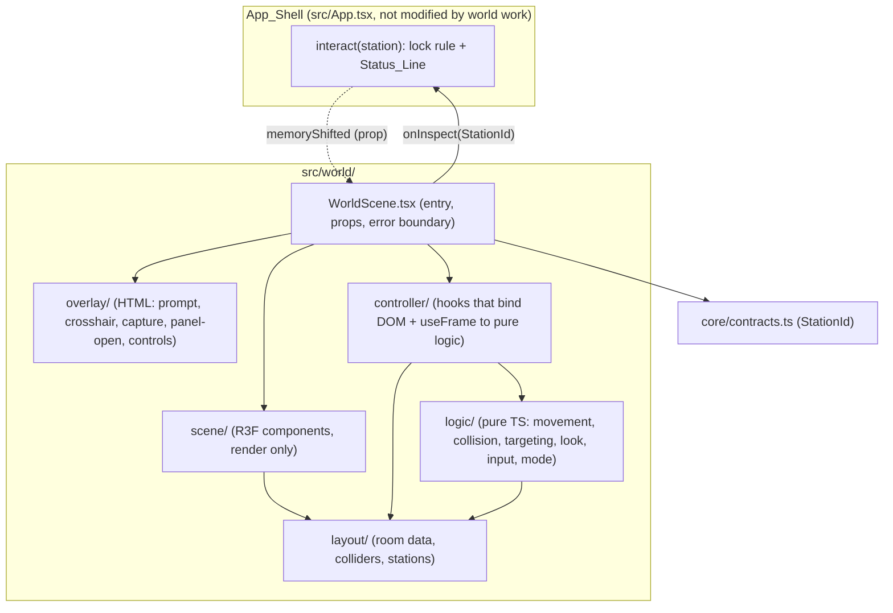
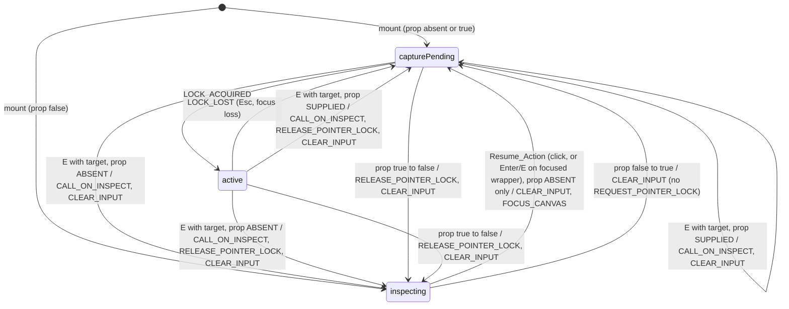

# Design Document: World Exploration

## Overview

This document designs the World_Module (`src/world/`, Developer 1, branch `feature/world-exploration`) of THE LOST MEMORY CLUB. It replaces the click-to-inspect prototype in `src/world/WorldScene.tsx` with a first-person, collision-aware, atmospheric VHS archive. It implements `.kiro/specs/world-exploration/requirements.md` and uses the same terms (Player, Station, Collider, Inspecting_State, and so on).

Status: every item here is **planned**. Numeric values (speed 2.5 u/s, Player_Radius 0.35, range 2.0, cone 35 degrees, DPR cap 1.5, and so on) are initial values to be validated in testing. No performance figure may be reported as achieved before it is measured (Requirement 14.11, 14.12).

### Design goals

1. A playable single room first (Milestone 1), then incremental additions that never change `WorldSceneProps` or M1 behavior (Requirement 19.10).
2. All decisions about movement, collision, targeting, look angles, key filtering and input state live in **pure TypeScript modules** with no React, three.js or DOM imports, so they can be unit and property tested without a GPU (Requirement 13).
3. The world is **lock-agnostic**. It never reads GameState, never knows whether the arcade is locked, and always calls `onInspect` (Requirement 16.6, 16.7, 20).
4. No file outside `src/world/` and `.kiro/specs/world-exploration/` is modified without an approved proposal (Requirement 17).

### Research summary and sources

Findings that inform the design (content paraphrased from the cited documentation):

- The Pointer Lock API reports state changes through `pointerlockchange` on `document` and failures through `pointerlockerror`. `requestPointerLock()` may be refused if it is not called from a user gesture, and after the user leaves lock with Esc, browsers may impose a short delay before the next request is accepted. Mouse deltas come from `MouseEvent.movementX/movementY`. See [MDN Pointer Lock API](https://developer.mozilla.org/en-US/docs/Web/API/Pointer_Lock_API). This drives the denial fallback (Requirement 5.2) and the rule that a request is only made from a click handler.
- React Three Fiber's `<Canvas frameloop>` supports `"always"`, `"demand"` and `"never"`. `useFrame` runs per rendered frame with a delta in seconds. Per-frame state should be mutated through refs rather than React state to avoid re-rendering at 60 Hz. See [R3F Canvas API](https://r3f.docs.pmnd.rs/api/canvas) and [R3F performance pitfalls](https://r3f.docs.pmnd.rs/advanced/pitfalls).
- three.js `GLTFLoader` ships in `three/examples/jsm/loaders/GLTFLoader.js` and is sufficient for GLB loading, so `@react-three/drei` is not required (proposal P5 fallback). See [three.js GLTFLoader](https://threejs.org/docs/#examples/en/loaders/GLTFLoader).
- Browsers expose `prefers-reduced-motion` through `matchMedia`, with a `change` event for live updates. See [MDN prefers-reduced-motion](https://developer.mozilla.org/en-US/docs/Web/CSS/@media/prefers-reduced-motion). WCAG 2.3.1 limits flashing to three per second, which matches Requirement 10.2.

Content was rephrased for compliance with licensing restrictions.

### Key design decisions

| # | Decision | Rationale | Alternative rejected |
|---|----------|-----------|----------------------|
| D1 | Colliders are axis-aligned boxes (AABB) on the floor plane. Player is a circle. | Rooms made of boxes need no more. Circle-vs-AABB has a closed-form push-out, which is simple to prove properties for. | Mesh or BVH collision: heavy, not needed. |
| D2 | Collision resolves axis by axis (X then Z), with substeps, to give wall sliding. | Sliding follows from per-axis resolution (Requirement 6.3). Substeps prevent tunneling (Requirement 6.6). | Single-step circle sweep: more code, same result here. |
| D3 | Inspecting_State is a pure reducer (`inputMode`) driven by events. React and DOM listeners only translate events. | Testable without a browser (Requirement 13.9, 13.10). | State inside component effects: untestable. |
| D4 | Per-frame data (position, yaw, pitch, held keys) lives in refs, not React state. Only prompt target and mode go to React state, and only when they change. | Avoids 60 Hz re-renders on integrated graphics. | Everything in `useState`. |
| D5 | `frameloop="always"` while input is enabled, `"demand"` while Inspecting and not animating. | Saves GPU while a panel is open. The effect loop invalidates when an effect or a Memory_Shift transition runs. | Always render: wastes GPU while panel open. |
| D6 | Interaction targeting uses distance, cone and a segment-vs-AABB line-of-sight test against Colliders. A Station's own Collider is excluded from its own occlusion test. | Meets Requirement 7.3 without raycasting meshes. | three.js Raycaster: couples logic to the scene graph. |
| D7 | Layout is one data module (`layout.ts`). Colliders, Station anchors, props and bounds are all derived from it. Meshes and GLBs only decorate it. | Requirement 12.5 and 9.3: collision does not depend on visuals or on `memoryShifted`. | Colliders read from meshes. |
| D8 | Property tests use `fast-check` with a fixed, printed seed. Component tests use `jsdom` and `@testing-library/react` (plus `@testing-library/dom` if required as a peer). These are the approved default (P9) and are added to `package.json` only when the corresponding testing tasks are implemented. The jsdom environment is selected per test file with a `// @vitest-environment jsdom` docblock, so Pure_Logic tests keep the default environment and the Vitest config stays unchanged. If a global config change proves unavoidable, it is flagged for review. A small seeded generator (`mulberry32`) and reducer-level tests are a fallback only if installation or compatibility with React 19, TypeScript 5.9 or Vitest 3 fails (Requirement 13.12 to 13.14, 17.5). | Property testing prefers a maintained library over a hand-written generator. Per-file docblocks keep the global test setup untouched. Seeds make failures reproducible (Requirement 13.11). | Global jsdom environment; hand-written generator as default. |

## Architecture

### Layers



Dependency rules:

- `logic/` imports only `layout/` types and `core/contracts.ts` types. It imports no React, three.js, DOM or WebGL API (Requirement 13.1).
- `scene/` and `overlay/` are rendering only. They hold no rules.
- `controller/` is the only layer that touches `window`, `document` and the canvas element.
- Nothing in `src/world/` imports from `src/arcade/`, `src/memories/` or reads storage (Requirement 16.8, 16.9). An import-boundary test enforces this.

### Proposed file tree (all inside `src/world/`)

```
src/world/
  WorldScene.tsx              # exported entry; WorldSceneProps; error boundary; WebGL check
  WorldScene.test.tsx         # component test (jsdom docblock, P9 approved), see Testing Strategy
  worldTypes.ts               # world-local types (Vec2, Aabb, StationDef, InputMode ...)
  layout/
    roomLayout.ts             # dimensions, bounds, colliders, stations, props (single source of truth)
    roomLayout.test.ts        # reachability, counts, collider/anchor sanity
  logic/
    constants.ts              # WALK_SPEED, PLAYER_RADIUS, RANGE, CONE, PITCH_LIMIT, DT_MAX ...
    movement.ts               # clampDt, inputVector, stepMovement
    collision.ts              # resolveCircleAabb, moveWithCollision, clampToBounds, relocateToValid
    look.ts                   # applyMouseLook, applyKeyboardLook, wrapYaw, clampPitch
    targeting.ts              # selectInteractionTarget, segmentIntersectsAabb
    inputState.ts             # key filtering, held-key reducer (blur/visibility/suspension clears)
    inputMode.ts              # Inspecting_State machine reducer
    palette.ts                # memoryShifted palette, transition progress, flicker function
    *.test.ts                 # unit and property tests per module
    testing/seededRandom.ts   # fallback only: created if fast-check cannot be installed (Req 13.14)
  controller/
    useWorldInput.ts          # DOM listeners -> inputState/inputMode events; cleanup
    usePointerLock.ts         # request / release / error / fallback detection
    usePlayerRig.ts           # useFrame loop: movement, look, camera, target evaluation
    useReducedMotion.ts       # matchMedia + optional reducedDistortion prop
  scene/
    WorldCanvas.tsx           # <Canvas> config (DPR cap, frameloop, no shadows)
    Room.tsx                  # floor, ceiling, walls
    Props.tsx                 # desk, shelves, boxes, posters (instanced where repeated)
    Stations.tsx              # CRT + VHS player, arcade cabinet, attract screen
    Lighting.tsx              # <= 4 dynamic lights, palette-driven
    Effects.tsx               # M4: flicker, dust, CRT static (reduced-motion aware)
    sharedResources.ts        # shared geometries/materials, dispose helper
  overlay/
    WorldOverlay.tsx          # container inside World_Wrapper
    InteractionPrompt.tsx     # role="status" live region
    Crosshair.tsx
    CaptureOverlay.tsx
    PanelOpenNotice.tsx
    ControlsHint.tsx
    WebglFallback.tsx         # text + two buttons
    world.css                 # overlay styles if P3 is not approved (imported from src/world/)
  assets/                     # M5
    AssetModel.tsx            # Suspense + error boundary + primitive fallback
    assetManifest.ts          # object id -> GLB path, triangle budget
    loadGlb.ts                # GLTFLoader wrapper, single warning per path
```

Files outside `src/world/` that the design touches are listed only as proposals (see Integration proposals).

## Components and Interfaces

### Public contract (unchanged)

```ts
// src/world/WorldScene.tsx
export interface WorldSceneProps {
  onInspect: (station: StationId) => void; // StationId from ../core/contracts
  memoryShifted: boolean;
  // Additive, optional, backward compatible. Absent means default.
  inputEnabled?: boolean;      // P1 (approved as integration proposal only), default true
  reducedDistortion?: boolean; // P2 (pending), default false
}
export function WorldScene(props: WorldSceneProps): JSX.Element;
```

`inputEnabled?: boolean` (default true) may be declared in the type. It is additive, so existing call sites stay valid (Requirement 16.12). The approval of P1 covers the integration proposal only. `src/App.tsx` is **not modified** until the team has coordinated the change (Requirement 17.5, 17.7), so the App_Shell does not pass the prop yet and the World_Module must behave correctly both with and without it (Requirement 11.25). `reducedDistortion?: boolean` is declared only after P2 is approved. Until then the controller treats it as `false`. P1 and P2 are independent (Requirement 17.8).

`WorldScene` renders `div.world-wrapper` and keeps all overlays inside it, so the App_Shell Status_Line (`div.scene-status`, rendered after the wrapper) is never covered (Requirement 20.8). The wrapper keeps its existing class and sits inside `section.scene-card` with no layout change (Requirement 2.1). Overlays use `position: absolute` within the wrapper.

### Coordinate system and units

- Right-handed three.js axes, 1 unit = 1 metre. `y` is up. Floor plane is `(x, z)`. Floor-plane vectors are `Vec2 = { x: number; z: number }`.
- `yaw = 0` looks toward `-z`. Positive yaw turns left (counter-clockwise seen from above).
- Forward (horizontal): `f(yaw) = (-sin yaw, -cos yaw)`. Right: `r(yaw) = (cos yaw, -sin yaw)`.
- `pitch` in radians, positive looks up. Eye height `EYE_HEIGHT = 1.6`.

### Pure logic API

```ts
// worldTypes.ts
export interface Vec2 { x: number; z: number }
export interface Aabb { minX: number; maxX: number; minZ: number; maxZ: number }
export interface MovementInput { forward: boolean; backward: boolean; left: boolean; right: boolean }
export interface StationDef {
  id: StationId;
  anchor: Vec2;        // point on the Station front face used for distance and cone
  collider: Aabb;      // the Station's own Collider
}

// logic/constants.ts (initial values, validated in testing)
export const WALK_SPEED = 2.5;
export const PLAYER_RADIUS = 0.35;
export const INTERACTION_RANGE = 2.0;
export const INTERACTION_CONE_DEG = 35;
export const PITCH_LIMIT_DEG = 80;
export const KEY_LOOK_DEG_PER_SEC = 90;
export const MOUSE_SENSITIVITY = 0.0022;   // rad per pixel
export const MOUSE_DELTA_MAX = 500;        // px, larger deltas ignored
export const DT_MAX = 0.1;                 // s
export const MAX_STEP = 0.1;               // u per collision substep
```

```ts
// logic/movement.ts
export function clampDt(dt: number): number;           // NaN/negative -> 0; > DT_MAX -> DT_MAX
export function inputVector(input: MovementInput, yaw: number): Vec2;
  // Combines axes, cancels opposing keys, normalizes so |v| is 0 or 1 (Req 3.5).
export function stepMovement(pos: Vec2, yaw: number, input: MovementInput, dt: number,
                             speed?: number): Vec2;
  // pos + inputVector * speed * clampDt(dt). No collision. (Req 3.10)
```

```ts
// logic/collision.ts
export function resolveCircleAabb(p: Vec2, r: number, box: Aabb): Vec2;
  // If circle (p, r) overlaps box, return nearest non-overlapping point; else p.
  // closest = clamp(p, box); d = p - closest; if |d| > 0 push to r along d;
  // if p is inside the box, push out along the axis of least penetration.
export function resolveAll(p: Vec2, r: number, boxes: readonly Aabb[]): Vec2;
  // Iterates a fixed small number of passes (4) until stable.
export function clampToBounds(p: Vec2, r: number, bounds: Aabb): Vec2;
export function moveWithCollision(pos: Vec2, displacement: Vec2, r: number,
                                  boxes: readonly Aabb[], bounds: Aabb): Vec2;
  // n = ceil(|displacement| / MAX_STEP) substeps. Each substep:
  //   x' = pos.x + dx/n ; resolveAll ; clampToBounds
  //   z' = pos.z + dz/n ; resolveAll ; clampToBounds
  // Axis-separated resolution gives wall sliding (Req 6.3).
export function overlapsAny(p: Vec2, r: number, boxes: readonly Aabb[]): boolean;
export function relocateToValid(p: Vec2, r: number, boxes: readonly Aabb[],
                                bounds: Aabb, fallback: Vec2): Vec2;
  // Req 6.7: resolve; if still invalid after passes, spiral search on a 0.1 grid; else fallback.
```

Walls are four Colliders placed just outside the room bounds, so `clampToBounds` is a second safety net rather than the primary mechanism.

```ts
// logic/look.ts
export interface Look { yaw: number; pitch: number }
export function clampPitch(pitch: number): number;      // [-80deg, +80deg] in radians; NaN -> 0
export function wrapYaw(yaw: number): number;           // result in (-PI, PI]; non-finite -> 0
export function applyMouseLook(look: Look, dx: number, dy: number,
                               sensitivity?: number): Look;
  // Ignores the whole delta pair on an axis if |delta| > MOUSE_DELTA_MAX or non-finite (Req 4.5).
  // yaw -= dx * s ; pitch -= dy * s ; then wrap/clamp.
export interface LookKeys { yawLeft: boolean; yawRight: boolean; pitchUp: boolean; pitchDown: boolean }
export function applyKeyboardLook(look: Look, keys: LookKeys, dt: number): Look;
  // 90 deg/s * clampDt(dt), then wrap/clamp (Req 5.3, 5.5).
```

```ts
// logic/targeting.ts
export function selectInteractionTarget(
  pos: Vec2, yaw: number, stations: readonly StationDef[], colliders: readonly Aabb[],
  range?: number, coneDeg?: number
): StationId | null;
  // For each station: d = anchor - pos; dist = |d|; require dist <= range;
  // angle between forward(yaw) and d <= coneDeg (dist ~ 0 counts as in cone);
  // line of sight: segment pos->anchor must not intersect any collider other than the
  // station's own collider (Req 7.3). Pick the smallest dist (ties: first in list order). (Req 7.4)
export function segmentIntersectsAabb(a: Vec2, b: Vec2, box: Aabb): boolean; // slab method
```

Targeting is 2D on the floor plane. Pitch is ignored, so looking up or down does not change the target. This is deliberate and documented in the controls hint tests.

```ts
// logic/inputState.ts
export interface KeyRoles { /* movement, look, interact, resume */ }
export type KeyRole = 'forward' | 'backward' | 'left' | 'right'
                    | 'yawLeft' | 'yawRight' | 'pitchUp' | 'pitchDown' | 'interact';
export function keyRole(code: string): KeyRole | null;
  // KeyW/ArrowUp, KeyS/ArrowDown, KeyA/ArrowLeft, KeyD/ArrowRight, KeyJ, KeyL, KeyI, KeyK, KeyE.
  // Uses event.code so layouts such as AZERTY are consistent with the on-screen hint (hint states physical keys).
export interface KeyTargetInfo { tagName: string; isContentEditable: boolean; insideWorldWrapper: boolean }
export function isKeyEventAccepted(t: KeyTargetInfo): boolean;
  // false for input, textarea, select, button, contentEditable, or outside the wrapper (Req 11.12, 11.13).
export interface HeldKeys { readonly roles: ReadonlySet<KeyRole> }
export type HeldKeyEvent =
  | { type: 'down'; role: KeyRole } | { type: 'up'; role: KeyRole }
  | { type: 'clear' };                       // blur, hidden, pointerlockchange, suspension (Req 3.8, 3.9)
export function reduceHeldKeys(s: HeldKeys, e: HeldKeyEvent): HeldKeys;
export function toMovementInput(s: HeldKeys): MovementInput;
export function toLookKeys(s: HeldKeys): LookKeys;
```

```ts
// logic/inputMode.ts  (Inspecting_State machine)
export type InputMode = 'capturePending' | 'active' | 'inspecting';
export interface ModeState {
  mode: InputMode;
  pointerLocked: boolean;
  keyboardLookHint: boolean;      // true after denial or unsupported API
  inputEnabled: boolean | undefined; // undefined = prop absent; otherwise the supplied value
  eRepeatGuard: boolean;          // true while E is physically held after a press
}
export type ModeEvent =
  | { type: 'CANVAS_CLICK' }
  | { type: 'LOCK_ACQUIRED' } | { type: 'LOCK_LOST' } | { type: 'LOCK_DENIED' } | { type: 'LOCK_UNSUPPORTED' }
  | { type: 'KEY_DOWN'; role: KeyRole | null; code: string; repeat: boolean; accepted: boolean; hasTarget: boolean }
  | { type: 'KEY_UP'; role: KeyRole | null }
  | { type: 'EXTERNAL_ENABLED'; value: boolean }  // only sent while the prop is supplied and changes
  | { type: 'WINDOW_BLUR_OR_HIDDEN' };
export type ModeEffect =
  | { type: 'CALL_ON_INSPECT' }       // controller supplies the target StationId at call time
  | { type: 'RELEASE_POINTER_LOCK' } | { type: 'REQUEST_POINTER_LOCK' }
  | { type: 'CLEAR_INPUT' } | { type: 'FOCUS_CANVAS' };
export function reduceMode(s: ModeState, e: ModeEvent): { state: ModeState; effects: ModeEffect[] };
export function initialModeState(inputEnabled?: boolean): ModeState;
  // prop absent or true -> capturePending; prop false at mount -> inspecting. No effects at mount.
```

```ts
// logic/palette.ts
export interface Palette { background: string; ambient: string; ambientIntensity: number;
  fog: string; fogDensity: number; wall: string; screenEmissive: string; accentLight: string }
export const PALETTE_NORMAL: Palette;
export const PALETTE_SHIFTED: Palette;
export function transitionProgress(elapsedSec: number, durationSec: number, reducedMotion: boolean): number; // 0..1
export function blendPalette(t: number): Palette;
export function flickerFactor(timeSec: number, reducedMotion: boolean): number; // luminance multiplier
```

### Controller layer

`useWorldInput` registers `keydown`, `keyup`, `blur`, `visibilitychange` and canvas `click` listeners and returns a single cleanup function that removes every listener (Requirement 2.3). Key listeners are attached to the **World_Wrapper element** (it has `tabIndex` via the canvas), not to `window`, so panel keyboard input (Snake arrows, WASD, E) never reaches the world (Requirement 11.13). `window` receives only `blur`, and `document` receives `visibilitychange` and `pointerlockchange`/`pointerlockerror`. Listeners are not registered on `window` for keys at all.

`preventDefault` is called only when the accepted key role is one the world uses and the mode is `active` or `capturePending` with canvas focus (Requirement 11.15). Esc is never intercepted (Requirement 11.14).

`usePointerLock` calls `canvas.requestPointerLock()` only inside the click handler. If `requestPointerLock` is missing it dispatches `LOCK_UNSUPPORTED`. On `pointerlockerror` it dispatches `LOCK_DENIED`. On `pointerlockchange` it dispatches `LOCK_ACQUIRED` or `LOCK_LOST` and always also clears held keys and pending mouse deltas (Requirement 3.8).

`usePlayerRig` runs in `useFrame`. Per frame:

```
dt = clampDt(delta)
if mode != 'active': velocity = 0; skip movement and look; (keep camera still)
else:
  look = applyMouseLook(look, pendingDx, pendingDy); pendingDx = pendingDy = 0
  look = applyKeyboardLook(look, toLookKeys(held), dt)       // always available (Req 5.4)
  displacement = stepMovement(pos, look.yaw, toMovementInput(held), dt) - pos
  pos = moveWithCollision(pos, displacement, PLAYER_RADIUS, COLLIDERS, BOUNDS)
camera.position.set(pos.x, EYE_HEIGHT, pos.z); camera.rotation order 'YXZ', set (pitch, yaw, 0)  // no roll (Req 10.5)
target = selectInteractionTarget(pos, look.yaw, STATIONS, COLLIDERS)
if target != lastTarget: setTarget(target)   // React state only on change
```

### Input-suspension state machine

States (current props only):

| Mode | Meaning | Input processed | Overlays |
|------|---------|-----------------|----------|
| `capturePending` | World ready but pointer not locked (Ready_State). Entered at mount, after Esc, after a Resume_Action, after `inputEnabled` becomes true, and after `onInspect` while `inputEnabled` is supplied. Keyboard movement and keyboard look work when the canvas has focus. | Keys while canvas focused. Mouse look only after lock. | Capture_Overlay, controls hint, prompt if target, crosshair. |
| `active` | Pointer lock held. | Keys, mouse look, E. | Prompt if target, crosshair, controls hint. |
| `inspecting` | Input_Suspension in force. Entered (a) when `onInspect` is called and the prop is **absent**, or (b) while the supplied `inputEnabled` is **false**. | Nothing, except a Resume_Action when the prop is absent. | "Panel open" notice, no prompt, no crosshair. |

`capturePending` and `active` are both "Input_Enabled = true". The split exists only for the overlay (Requirement 4.6, 4.7) and mouse look (Requirement 4.2). Requirement 5.4 (keyboard look always available) holds in both.



Transition rules in `reduceMode`:

- **Interaction, prop absent.** `KEY_DOWN` with role `interact`, `accepted`, `!repeat`, `hasTarget`, mode not `inspecting`, and `eRepeatGuard` false: emit `CALL_ON_INSPECT`, `RELEASE_POINTER_LOCK`, `CLEAR_INPUT`, set mode `inspecting`, set `eRepeatGuard` (Requirement 11.3, 11.4).
- **Interaction, prop supplied.** Same guard conditions, but the world does **not** enter `inspecting`. It emits `CALL_ON_INSPECT`, `RELEASE_POINTER_LOCK` (when locked), `CLEAR_INPUT`, and moves to or stays in `capturePending`, so the Capture_Overlay shows and one user gesture re-captures the mouse (Requirement 11.20, 11.21). The prop alone decides suspension, so a rejected locked-arcade request never leaves the world suspended.
- **Interaction guards.** `KEY_UP` of E clears `eRepeatGuard`. Held E and repeat events never emit a second call (Requirement 7.7). If `hasTarget` is false, nothing is emitted (Requirement 7.6).
- **Inspecting.** Every event except Resume_Action (prop absent only), `LOCK_*` (ignored), `EXTERNAL_ENABLED` and `WINDOW_BLUR_OR_HIDDEN` (clears only) is a no-op. No movement, look or `CALL_ON_INSPECT` is possible (Requirement 11.5).
- **Resume_Action, prop absent.** `CANVAS_CLICK`, or `KEY_DOWN` with code `Enter` or `KeyE` while the World_Wrapper has focus, moves to `capturePending`, emits `CLEAR_INPUT` and `FOCUS_CANVAS`, and sets `eRepeatGuard = true` for a resume by E so that the same key press is not an interaction (Requirement 11.8). The resume does not emit `REQUEST_POINTER_LOCK`. The user clicks again to look with the mouse (Requirement 11.7 shows the Capture_Overlay).
- **Resume_Action, prop supplied false.** Ignored: click, Enter and E do nothing until the prop becomes true (Requirement 11.22).
- **Normal click.** In `capturePending`, `CANVAS_CLICK` emits `FOCUS_CANVAS` and `REQUEST_POINTER_LOCK` (Requirement 11.1, 4.1).
- **Pointer-lock request origin.** `REQUEST_POINTER_LOCK` is emitted only by user-gesture events: `CANVAS_CLICK` or a key activation (`KEY_DOWN` of Enter or E while the wrapper has focus). It is never emitted by mount, focus changes, visibility changes, `LOCK_*` events, `EXTERNAL_ENABLED` events or `memoryShifted` changes (Requirement 4.10, 11.23). After `LOCK_DENIED`, no request is emitted until a new gesture (Requirement 4.11).
- **Esc.** Not handled by the reducer. The browser releases lock and `LOCK_LOST` follows. `onInspect` is never called for Esc (Requirement 11.14).
- **Blur, hidden.** `WINDOW_BLUR_OR_HIDDEN` emits `CLEAR_INPUT` in all modes and never changes the mode except that a lost lock arrives as `LOCK_LOST`.
- **Time.** No timer exists in the machine, so with the prop absent `inspecting` ends only by Resume_Action (Requirement 11.9).

Behavior of the optional `inputEnabled` prop (P1), layered on without changing behavior when absent:

- The controller passes the prop value into `initialModeState` and sends `EXTERNAL_ENABLED` only from an effect that fires when a supplied prop value changes. If the prop is `undefined`, `inputEnabled` stays `undefined` and the reducer follows the prop-absent rules above (Requirement 11.19, 11.25). An absent prop is treated as true for rendering purposes only. It is not the same as a supplied `true`, because after `onInspect` the absent case enters `inspecting` and the supplied case does not.
- `true -> false`: enter `inspecting` immediately, release lock, clear input, ignore input, hide prompt and crosshair, show the notice, without `CALL_ON_INSPECT` (Requirement 11.16).
- `false -> true`: leave `inspecting` and enter `capturePending` with the Capture_Overlay, without a Resume_Action and **without** `REQUEST_POINTER_LOCK` (Requirement 11.17, 11.18). Pointer lock follows only after a user gesture.
- With P1 implemented and App passing `inputEnabled={station === null}`, an unlocked request goes: E, `onInspect`, world in `capturePending`, App sets `station`, prop becomes false, world in `inspecting`, panel closes, prop becomes true, world in `capturePending`. A locked arcade request goes: E, `onInspect`, App shows the lock message and keeps `station === null`, world stays in `capturePending` and remains usable (Requirement 11.20).
- Until the team coordinates the `src/App.tsx` change, the App_Shell does not pass the prop and the prop-absent rules apply.

Known limitation (to be documented in the README, Requirement 11.10): while `inputEnabled` is not supplied, the world cannot see that the panel closed. It stays in `inspecting` until the user clicks the canvas or presses Enter or E while the wrapper has focus.

### Locked arcade: lock-agnostic world

- `Stations.tsx` renders the arcade cabinet with one fixed idle attract screen. It has no lock input (Requirement 20.6).
- `InteractionPrompt` text comes from a constant map: `vhs: 'Press E to inspect the CRT television'`, `arcade: 'Press E to use the arcade cabinet'` (Requirement 8.1, 8.6, 20.3).
- The controller calls `onInspect('arcade')` whenever E is accepted with the arcade as target. The App_Shell `interact` function decides, shows `ARCADE LOCKED · Recover the VHS clue first.` in `div.scene-status`, and does not call `setStation`. **While `inputEnabled` is absent**, the world enters `inspecting` on that call, because it cannot know the call was rejected. The "Panel open" notice would then be misleading, so the notice text is neutral: "Station request sent. Click the view or press Enter to continue exploring. Messages appear below the scene." (Requirement 11.6, 20.7.) The user needs one Resume_Action to continue. This is an accepted trade-off of the current props and is listed in the manual test matrix.

**While `inputEnabled` is supplied**, the world does not enter `inspecting` because of `onInspect`. After a locked arcade request the App keeps `station === null`, the prop stays true, and the world releases pointer lock, clears input, shows the Capture_Overlay and stays in `capturePending`, fully usable with one gesture to re-capture the mouse (Requirement 11.20, 11.21). The neutral "Panel open" notice appears only while the prop is false, that is, while a panel is actually open.
- The canvas `aria-label` and the controls hint both say that station messages, including why a station cannot be used yet, appear in the status line below the scene (Requirement 11.2, 20.7).
- The overlay container is `pointer-events: none` except for its buttons, and sits inside the wrapper. Nothing is positioned outside the wrapper, so `div.scene-status` is neither covered nor replaced (Requirement 20.8).

### Overlay components

| Component | Visible when | Content |
|-----------|--------------|---------|
| `CaptureOverlay` | mode `capturePending` (always shown while lock is inactive and input is enabled) | "Click to look around · Esc releases the mouse" |
| `InteractionPrompt` | target exists and mode is not `inspecting` | station text above, in `role="status"` live region |
| `Crosshair` | mode is not `inspecting` | small centered dot |
| `PanelOpenNotice` | mode `inspecting` only (prop absent after `onInspect`, or prop false). Never shown while the prop is supplied and true. | neutral text; names the Resume_Action only when the prop is absent |
| `ControlsHint` | always (collapsible) | W A S D and arrows, I J K L, E, Esc, plus the Status_Line message |
| `WebglFallback` | WebGL unavailable or render error | text and two `<button>`s calling `onInspect('vhs')` and `onInspect('arcade')` |

The live region exists in the DOM from first render and only its text changes, so assistive technology announces changes. Text contrast is at least 4.5:1 against a solid dark background chip. Interactive elements have a visible `:focus-visible` outline. Overlay text and labels are in English.

### Scene composition (Milestone 1)

Room (interior, metres): width 10 (x from -5 to 5), depth 8 (z from -4 to 4), height 3. Start position `(0, 3.0)` facing `-z` (`yaw = 0`), inside the walkable area.

Walls are four Colliders 0.3 thick placed outside the interior bounds:

| Collider | minX | maxX | minZ | maxZ |
|----------|------|------|------|------|
| wall north | -5.3 | 5.3 | -4.3 | -4.0 |
| wall south | -5.3 | 5.3 | 4.0 | 4.3 |
| wall west | -5.3 | -5.0 | -4.0 | 4.0 |
| wall east | 5.0 | 5.3 | -4.0 | 4.0 |

Object Colliders and Stations (initial layout, validated by the reachability test):

| Object | Center (x, z) | Size (x by z) | Collider | Notes |
|--------|---------------|---------------|----------|-------|
| Reception desk | (1.5, 0.5) | 2.4 by 0.8 | yes | M1 required |
| Shelf A | (-4.6, -1.5) | 0.6 by 2.2 | yes | M1 required, against west wall |
| Shelf B | (-4.6, 1.5) | 0.6 by 2.2 | yes | M1 required |
| Shelf C | (4.6, 2.0) | 0.6 by 2.0 | yes | M3 |
| CRT TV with VHS player (Station `vhs`) | (-2.5, -3.4) | 1.2 by 0.8 | yes | against north wall |
| Arcade cabinet (Station `arcade`) | (2.8, -3.4) | 0.9 by 0.8 | yes | against north wall |
| Abandoned chair, couch | (3.8, -1.2), (-3.0, 3.0) | 0.6 by 0.6, 1.8 by 0.8 | yes | M3 |

The free corridor between the desk and the north wall is 3.2 m wide minus the desk offset, far above the 0.7 m player diameter. Station anchors are on the front (south) face: `vhs` at `(-2.5, -2.95)`, `arcade` at `(2.8, -2.95)`. From those anchors, `INTERACTION_RANGE = 2.0` means the player stands within 2 m in front. Door frames and the Arcade_Area (M3) extend the layout: east wall opening to a second 4 by 4 area, with door Colliders that block the frame sides but not the opening. The M1 room contains no doors.

Lighting plan (at most 4 dynamic lights, no shadows):

1. `ambientLight`, palette-driven color and intensity.
2. `pointLight` over the CRT, cool teal.
3. `pointLight` near the arcade, magenta.
4. `pointLight` ceiling fill, dim warm. Held in reserve and used from M3.

Rendering settings (`WorldCanvas.tsx`): `dpr={[1, 1.5]}`, `shadows` off, `gl={{ antialias: true, powerPreference: 'high-performance' }}`, no post-processing in M1 (Requirement 19.3). Materials are `meshStandardMaterial` or `meshLambertMaterial` shared through `sharedResources.ts`. Repeated objects (shelf boards, tapes, boxes) use shared geometry and `InstancedMesh` where there are more than about 10 copies. Geometry stays below 20,000 triangles, computed from the layout in a test as an estimate (box = 12 triangles).

`memoryShifted` in M1: only background color and ambient light color change (Requirement 19.8). M4 extends it, see below.

### Memory_Shift design (M4, building on M1)

The visual state is a pure function of `memoryShifted` (Requirement 9.8). Four properties change:

| Property | Normal | Shifted |
|----------|--------|---------|
| Ambient/point light color | cool blue | warm red-pink |
| Background and fog color | deep blue | dark crimson |
| Screen emissive colors (CRT, arcade) | teal, magenta | pink, amber |
| Set dressing | none | extra poster, altered wall plaque (visual only, no Collider) |

A single `t` in 0..1 blends the palette. `t` moves toward the target by `dt / 2.0` (2 second transition, below the 3 second limit, Requirement 9.4). On mount with `memoryShifted = true`, `t` starts at 1 (Requirement 9.7). With reduced motion, `t` jumps to its target (Requirement 9.5). The set-dressing meshes fade in with `t` through material opacity, and are present but invisible at `t = 0`. Colliders and Station positions read from `roomLayout.ts` and never depend on `memoryShifted` (Requirement 9.3). Going `true -> false` runs the same blend backwards (Requirement 9.6). The canvas is never remounted (Requirement 9.1). The transition requests frames in `frameloop="demand"` through `invalidate()` until `t` reaches the target.

### Environmental effects (M4)

- **Light flicker**: `flickerFactor(time)` is a smooth, low-amplitude (at most 15 percent) function that crosses its mean at most 2 times per second, so luminance changes stay under 3 per second (Requirement 10.2). Applied only to the CRT point light.
- **Screen glow variation**: slow sine on emissive intensity (0.5 Hz).
- **Dust**: a single `Points` object with about 150 points drifting slowly, one draw call.
- **CRT static**: a small `CanvasTexture` (64 by 64) updated at most 12 times per second with low-contrast noise, restricted to the CRT screen. Optionally a very light fragment shader adds horizontal scanlines. Both are disabled under reduced motion and replaced with a static texture (Requirement 10.3).
- No screen shake, camera roll or forced camera movement exists anywhere in the code (Requirement 10.5). Camera rotation is set only from Look.
- `useReducedMotion` reads `matchMedia('(prefers-reduced-motion: reduce)')`, subscribes to `change`, and ORs the optional `reducedDistortion` prop (Requirement 10.4, 10.6). Readability: a minimum ambient intensity floor in both palettes keeps floor, walls and Stations distinguishable (Requirement 10.7).

### WebGL detection and error boundary

`WorldScene` checks WebGL before mounting the Canvas by creating a throwaway canvas and requesting `webgl2` or `webgl`. If neither is available, it renders `WebglFallback`. `WorldErrorBoundary` wraps the Canvas and renders the same fallback if rendering throws, also on `webglcontextlost` without restore after 3 seconds (Requirement 2.5, 2.6). The fallback text: "3D rendering is unavailable in this browser. Use these buttons to interact with the stations." Buttons are keyboard-operable and call `onInspect('vhs')` and `onInspect('arcade')`.

### Blender/GLB integration plan (M5)

- **Assets**: `public/models/*.glb`, loaded by URL (`/models/<name>.glb`). A manifest `assets/assetManifest.ts` maps layout object ids to optional GLB paths and triangle budgets. With an empty manifest, the whole scene renders from primitives (Requirement 12.1).
- **Loader**: `three/examples/jsm/loaders/GLTFLoader` (no new dependency, P5 fallback). `AssetModel` wraps each object in `<Suspense fallback={primitive}>` and an error boundary whose fallback is the same primitive. On load failure `loadGlb.ts` calls `console.warn` once per path with the message `[world] GLB asset failed to load, using primitive fallback: <path>` (Requirement 12.3). While loading, the primitive stays visible and movement is not blocked, since loading happens outside the frame loop (Requirement 12.4).
- **Collision independence**: Colliders and Station anchors come from `roomLayout.ts` and are not read from GLB geometry (Requirement 12.5).
- **Budgets**: at most 5 MB of GLB loaded at startup, at most 5,000 triangles per prop and 20,000 for the whole environment. A build-time check script reads the manifest budgets (not the files) and a manual checklist verifies real file sizes.
- **Disposal**: loaded GLB geometries, materials and textures are disposed on unmount.
- **Blender scripts**: `tools/blender/` is approved (P10) for original Python `bpy` asset-generation and export scripts, with a `README.md`, English comments and usage instructions (for example `export_glb.py` and a batch triangle counter). Scripts and Blender models belong to Milestone 5. Milestone 1 works without Blender and without any GLB asset (Requirement 12.8, 12.9).
- **Licensing**: every GLB added is recorded in `docs/THIRD_PARTY_ASSETS.md` (source, author, license, modifications). That file is outside the world boundary and its change is **pending approval (P6)**. Until approval, the record lives in `.kiro/specs/world-exploration/asset-log.md` and is moved after approval.
- Only original or properly licensed assets are used (Requirement 12.6).

### Milestone-to-component mapping

| Milestone | Components and modules delivered |
|-----------|----------------------------------|
| M1 Playable room (one small, enclosed, low-poly room; no post-processing, no advanced shaders, no GLB, no Blender) | `WorldScene.tsx`, `roomLayout.ts` (single room: walls, desk, 2 shelves, CRT, arcade), `logic/{constants,movement,collision,look,targeting,inputState,inputMode}.ts`, `controller/{useWorldInput,usePointerLock,usePlayerRig}.ts`, `scene/{WorldCanvas,Room,Props,Stations,Lighting,sharedResources}.tsx`, `overlay/{WorldOverlay,InteractionPrompt,Crosshair,CaptureOverlay,PanelOpenNotice,ControlsHint}.tsx`, `WebglFallback`, minimal `palette.ts` (background and ambient only), M1 tests |
| M2 Movement polish | Keyboard look wiring and hint (`applyKeyboardLook`), pointer-lock denial and unsupported fallback paths, full controls hint |
| M3 Layout and interactions | Arcade_Area, doors, shelf C, furniture, 5+ detail objects, colliders for them, line-of-sight with doors, feedback ownership text and aria-label (Requirement 20) |
| M4 Effects and Memory_Shift | `palette.ts` full blend, `Effects.tsx`, `useReducedMotion`, set-dressing, fog |
| M5 Blender/GLB | `assets/*`, manifest, `tools/blender/` (pending), asset records |
| M6 Test and optimize | Property tests completed, performance measurements, manual matrix results, budgets verified |

The P9 test tooling (`fast-check`, `jsdom`, `@testing-library/react`, and `@testing-library/dom` if required) is introduced with the testing tasks, not before, so M1 implementation changes no `package.json` entry apart from those test dependencies (Requirement 19.11). M2 to M6 only add files or extend functions. The `WorldSceneProps` contract and M1 behavior stay unchanged (Requirement 19.10).

## Data Models

```ts
// layout/roomLayout.ts
export interface RoomLayout {
  bounds: Aabb;                       // interior walkable rectangle, e.g. {-5,5,-4,4}
  height: number;                     // 3
  start: { pos: Vec2; yaw: number };  // {x:0, z:3.0}, yaw 0
  colliders: readonly Aabb[];         // walls + objects + stations
  stations: readonly StationDef[];
  props: readonly PropDef[];          // visual-only and collider-bearing objects
}
export interface PropDef {
  id: string;
  kind: 'desk' | 'shelf' | 'chair' | 'couch' | 'box' | 'poster' | 'tape' | 'cable' | 'door' | 'crt' | 'arcade';
  center: Vec2; size: { x: number; y: number; z: number };
  rotationY: number;
  collider: Aabb | null;              // derived by a helper from center and size
  milestone: 1 | 3;                   // M1 objects render from the start
  glbPath?: string;                   // M5, optional
}
export const ROOM: RoomLayout;
export function reachableCells(layout: RoomLayout, r: number, cell: number): Set<string>; // test helper, BFS on a grid
```

Derived data is computed once at module load (`colliders`, station colliders, anchors). `ROOM` is frozen and contains no field that depends on `memoryShifted`.

Runtime player state (in refs, not React state):

```ts
interface PlayerRuntime {
  pos: Vec2; look: Look; held: HeldKeys; pendingDx: number; pendingDy: number; velocity: Vec2;
}
```

React state is limited to `{ modeState: ModeState, target: StationId | null, webglOk: boolean }`.

## Correctness Properties

*A property is a characteristic or behavior that should hold true across all valid executions of a system-essentially, a formal statement about what the system should do. Properties serve as the bridge between human-readable specifications and machine-verifiable correctness guarantees.*

Prework reflection: movement-direction (3.1 to 3.3) and diagonal-speed (3.5) criteria are merged into one input-vector property. Bounds (6.4) and no-overlap (6.5) are merged into one invariant. Look clamp (4.3), yaw finiteness (4.4) and delta rejection (4.5) are combined, and keyboard look (5.3, 5.5) is kept separate. Pure targeting selection (7.1 to 7.4) is one property. Blur, visibility, suspension clearing (3.8, 3.9, 11.4) is one property. UI-only, rendering and performance criteria are covered by example, integration or manual tests and have no property.

### Property 1: Input vector direction and speed

For any yaw and any combination of movement keys, `inputVector` has length 0 (no net input) or 1; a lone forward, backward, left or right key gives the corresponding direction relative to the yaw; and for any two or more keys, the length does not exceed that of a single key.

**Validates: Requirements 3.1, 3.2, 3.3, 3.4, 3.5**

### Property 2: Frame-rate independent movement with clamped dt

For any position, yaw, input and elapsed time `dt`, without obstacles the displacement length of `stepMovement` equals `WALK_SPEED * clampDt(dt)` (or 0 with no net input), where `clampDt(dt)` is in `[0, 0.1]` for every finite or non-finite `dt`. Splitting a frame of duration `d` (at most 0.1) into two equal steps yields the same final position as one step, within floating-point tolerance.

**Validates: Requirements 3.6, 3.10, 3.11**

### Property 3: Position invariant (bounds and no overlap)

For any sequence of frames, each with any movement input, yaw and elapsed time (including values above the clamp), starting from any valid position, the player circle always stays inside the room bounds and never overlaps any Collider after `moveWithCollision`.

**Validates: Requirements 6.2, 6.4, 6.5, 6.8, 6.9**

### Property 4: Wall sliding preserves the tangential component

For any position near a single axis-aligned wall and any displacement with a component both into the wall and along it, the resolved position keeps the along-wall component of the displacement (within substep tolerance) and removes only the into-wall component.

**Validates: Requirements 6.3**

### Property 5: No tunneling through thin colliders

For any start position on one side of a Collider thinner than 0.2 units and any displacement of length up to `WALK_SPEED * DT_MAX` toward and through it, the resolved position stays on the starting side.

**Validates: Requirements 6.6**

### Property 6: Collision resolution is idempotent

For any position, resolving it with `resolveAll`, then resolving the result again with zero displacement, returns the same position. For any position that overlaps a Collider, `relocateToValid` returns a position inside the bounds that does not overlap any Collider.

**Validates: Requirements 6.2, 6.7**

### Property 7: Look angles stay valid

For any sequence of mouse deltas (including non-finite values and magnitudes above 500 pixels) and any sequence of keyboard look keys with any `dt`, the resulting pitch lies in `[-80, +80]` degrees, the yaw is finite and in `(-PI, PI]`, and a delta with magnitude above 500 on an axis leaves that axis unchanged.

**Validates: Requirements 4.2, 4.3, 4.4, 4.5, 5.3, 5.5**

### Property 8: Interaction target is valid and nearest

For any position, yaw, set of Stations and Colliders, `selectInteractionTarget` returns `null` or a Station whose anchor is within `INTERACTION_RANGE` and within the `INTERACTION_CONE`, with no non-station Collider blocking the segment. When more than one Station is eligible, the returned Station has the smallest distance. When no Station is eligible, the result is `null`.

**Validates: Requirements 7.1, 7.2, 7.3, 7.4, 7.8**

### Property 9: Interaction calls `onInspect` at most once per key press

For any sequence of mode events (clicks, key downs with and without `repeat`, key ups, lock changes, blur), the number of `CALL_ON_INSPECT` effects equals the number of fresh E key presses accepted while the mode is not `inspecting` and a target exists; held or repeated E, E without a target, and Esc never produce an effect.

**Validates: Requirements 7.5, 7.6, 7.7, 11.14**

### Property 10: Inspecting state ignores world input

For any sequence of events applied while the mode is `inspecting`, the reducer emits no `CALL_ON_INSPECT`, and `toMovementInput` and `toLookKeys` of the held-key state yield no input. Where the prop is absent, the mode leaves `inspecting` only on a Resume_Action. Where the prop is supplied and false, the mode stays `inspecting` for every event except `EXTERNAL_ENABLED true`, and click, Enter and E are ignored. Where the prop is absent, entering `inspecting` happens exactly when `CALL_ON_INSPECT` is emitted. Where the prop is supplied, no `CALL_ON_INSPECT` emission changes the mode to `inspecting`, and the mode is `inspecting` exactly while the prop is false.

**Validates: Requirements 11.3, 11.4, 11.5, 11.9, 11.16, 11.20, 11.21, 11.22**

### Property 11: Resume does not trigger an interaction

For any state in `inspecting` with the prop absent, and a Resume_Action performed by pressing E or Enter, the resulting state is `capturePending`, no `CALL_ON_INSPECT` effect is emitted for that key press, and the following key repeat events do not emit one either.

**Validates: Requirements 11.7, 11.8**

### Property 12: Prop-absent and prop-supplied behavior

For any event sequence without `EXTERNAL_ENABLED`, a machine with the prop absent and a machine with the prop supplied as `true` produce identical states and effects up to, but not including, the first `CALL_ON_INSPECT`. At that event both emit `CALL_ON_INSPECT`; afterwards the absent machine is in `inspecting` and the supplied-true machine is in `capturePending`. For any sequence with the prop supplied that contains `true -> false -> true`, the mode after the final event is `capturePending`, and no `REQUEST_POINTER_LOCK` effect is emitted by the `false -> true` change.

**Validates: Requirements 11.17, 11.18, 11.19, 11.20, 11.21, 11.25**

### Property 13: Input clearing

For any held-key state and any of the events `blur`, `visibilitychange` hidden, `pointerlockchange`, or entering `inspecting`, the resulting held-key set is empty and pending mouse deltas are zero.

**Validates: Requirements 3.8, 3.9, 11.4, 11.11**

### Property 14: Key event filtering

For any key event whose target is an input, textarea, select, button or contenteditable element, or an element outside the World_Wrapper, `isKeyEventAccepted` is false, so that the event produces no movement, look or interaction and `preventDefault` is not called. For an event inside the wrapper whose target is none of those, it is accepted.

**Validates: Requirements 11.12, 11.13, 11.15**

### Property 15: Layout reachability and collision independence

For the room layout, every Station anchor has an approach cell that is reachable from the start position on a grid of walkable cells (cells where a circle of `PLAYER_RADIUS` does not overlap any Collider), and the layout colliders and Station anchors are identical for `memoryShifted` true and false.

**Validates: Requirements 1.2, 1.7, 9.3, 12.5, 13.8**

### Property 16: Flicker stays below the flash limit and Memory_Shift completes in time

For any time window of one second and any start time, the luminance multiplier from `flickerFactor` changes direction (local extrema) at most 3 times; with reduced motion it is constant. For any elapsed time of at least 3 seconds, `transitionProgress` returns 1, and with reduced motion it returns 1 for any elapsed time.

**Validates: Requirements 9.4, 9.5, 10.2, 10.3**

### Property 17: Pointer lock is requested only from a user gesture

For any sequence of mode events (mount, `EXTERNAL_ENABLED` changes, `LOCK_*` events, blur and visibility events, memoryShifted-driven re-renders, clicks and key presses), with the prop absent or supplied, every `REQUEST_POINTER_LOCK` effect is emitted by a `CANVAS_CLICK` or a key-activation `KEY_DOWN` event, and never by any other event. After `LOCK_DENIED`, no `REQUEST_POINTER_LOCK` is emitted until a new gesture event occurs.

**Validates: Requirements 4.10, 4.11, 11.18, 11.23**

## Error Handling

| Condition | Detection | Behavior |
|-----------|-----------|----------|
| WebGL unavailable | Throwaway canvas context check before mount | Render `WebglFallback` (text and two buttons calling `onInspect`) (Requirement 2.5) |
| Render error or lost context | `WorldErrorBoundary`, `webglcontextlost` without restore | Same fallback instead of a blank area (Requirement 2.6). Listeners and pointer lock are released on unmount |
| Pointer Lock API missing | `typeof canvas.requestPointerLock !== 'function'` | `LOCK_UNSUPPORTED`, show controls hint explaining keyboard look and WASD |
| Pointer lock denied or rejected | `pointerlockerror` event or rejected promise | `LOCK_DENIED`, same hint. Mode stays `capturePending`, movement and I J K L keep working. The request is **not retried** without a new user gesture (Requirement 4.11, 5.2) |
| Lost lock (Esc, alt-tab) | `pointerlockchange` | `LOCK_LOST`, clear held keys and deltas, show Capture_Overlay |
| Start overlaps a Collider | `overlapsAny` at mount and on reset | `relocateToValid` (Requirement 6.7) |
| Non-finite numbers (NaN dt, mouse delta) | Guards in `clampDt`, `applyMouseLook`, `wrapYaw` | Treated as 0 or ignored. Position and angles stay finite |
| GLB missing or failing (M5) | Loader error boundary | Primitive fallback, one English warning per path (Requirement 12.3) |
| `matchMedia` unavailable | Feature check | Treat as no reduced motion preference |
| Listener leak | Unmount | Single cleanup function removes every listener and exits pointer lock (Requirement 2.3, 2.4); disposal of created geometries, materials and textures (Requirement 14.7) |

## Testing Strategy

### Why PBT applies here

The core of the module is pure functions with large input spaces and clear invariants (movement, collision, look angles, targeting, input state, mode reducer). These suit property-based testing. Rendering, overlays, WebGL fallback, performance and GLB loading are not suited to PBT and use example, mock-based or manual tests.

### Property-based tests

- **Library**: `fast-check` (approved, P9) with a fixed seed that is printed on failure (Requirement 13.12). It is added to `package.json` only when the property-test tasks are implemented, and it must be compatible with React 19, TypeScript 5.9 and Vitest 3. The fallback, used only if installation or compatibility fails, is a small seeded generator in `logic/testing/seededRandom.ts` (`mulberry32`), and the gap is recorded in the test report (Requirement 13.14).
- Minimum **100 iterations** per property (use 200 for Property 3 and 8), seed printed on failure and fixed by default (Requirement 13.11).
- Each correctness property is implemented by **one** property test. Each test carries a tag comment in the form: `Feature: world-exploration, Property N: <property text>`.
- Generators: positions inside the bounds and slightly outside; yaw from -10 PI to 10 PI; dt from -1 to 5 plus NaN and Infinity; key sets; mouse deltas from -2000 to 2000 plus NaN; random Station and Collider sets for targeting; random event sequences for the mode reducer.

### Unit and example tests (vitest, no GPU)

- `roomLayout.test.ts`: counts (at least 2 shelves in M1, 3 in M3), stations inside bounds, M1 contains reception desk, CRT and arcade, triangle estimate below 20,000, lights count constant at most 4.
- Pure functions: at least one typical and one boundary case each (Requirement 13.2), such as a position exactly touching a wall, a station exactly at range, yaw at the cone edge, pitch at exactly 80 degrees.
- `inputMode.test.ts`: the diagrams' transitions as examples, including denial fallback, resume by click, Enter and E with the prop absent, `onInspect` with the prop supplied true (no suspension), prop false (suspended, resume ignored) and false to true (no `REQUEST_POINTER_LOCK`).
- Prompt text map: exact strings for `vhs` and `arcade`, independent of any props (Requirement 8.6, 20.3).
- Import-boundary test: scans `src/world/**/*.ts(x)` import specifiers and fails on `../arcade`, `../memories`, or storage APIs, and fails if `logic/` imports `react`, `three`, or `@react-three/*` (Requirement 13.1, 16.8, 16.9).
- Component-level test (Requirement 13.9, 13.13): uses `jsdom` and `@testing-library/react` (plus `@testing-library/dom` if required), approved under P9. Each such file starts with `// @vitest-environment jsdom`, so Pure_Logic tests keep the default environment and no global Vitest configuration change is made. If a global change proves unavoidable, it is flagged for review. The test checks that E with an Interaction_Target calls `onInspect` with the right StationId and E without a target does not, with the prop absent and supplied. Only if installation or compatibility fails, the check falls back to reducer-level tests (`reduceMode` plus a fake controller harness) and the gap is recorded (Requirement 13.14).
- Mock-based tests: unmount removes all listeners and releases lock (spy on `addEventListener`/`removeEventListener`), WebGL fallback buttons call `onInspect`, GLB failure logs one warning (Requirement 2.3, 2.5, 12.3).
- `npm test` runs `vitest run` and must pass with no GPU or browser (Requirement 13.10).

### Manual test matrix (M6, results recorded in `.kiro/specs/world-exploration/manual-test-log.md`)

| Area | Checks |
|------|--------|
| Keyboard only | Tab to canvas, W A S D, arrows, I J K L, E on both Stations, Esc, resume by Enter |
| Pointer lock | Click to lock, Esc releases, alt-tab, denial (simulate by blocking in browser), unsupported browser |
| Panels | Open VHS panel, type; open arcade panel, press arrows and WASD; world does not move. Locked arcade message visible in Status_Line and not covered |
| Reduced motion | OS setting on and off while mounted, transition immediate, no flicker or static |
| Memory_Shift | Win flow in the App, transition under 3 s, mount with shifted state, colliders unchanged |
| WebGL failure | Disable hardware acceleration, check fallback |
| Browsers | Latest Chrome, Firefox, Edge |

### Performance validation (M6)

Targets (DPR cap 1.5, at most 4 lights, no shadows, 20,000 triangles, median frame at most 20 ms, 95th percentile at most 33 ms, first render within 3 s) are **planned** until measured.

- Method: build with `npm run build` and `npm run preview`; on the Reference_Hardware (integrated graphics laptop, 1280 by 720), record 60 seconds of a scripted walk loop with the browser Performance panel (or a temporary dev-only frame sampler using `performance.now()` deltas inside `useFrame`, removed or disabled in production). Compute the median and 95th percentile from the sample. Record first-render time from mount to the first `requestAnimationFrame` after Canvas creation.
- Triangle count and draw calls from `renderer.info` in the dev sampler.
- Record method, hardware, browser and results in `docs/` or the manual test log (location pending P6 style approval, default: `.kiro/specs/world-exploration/performance-log.md`). Until a result is recorded, README and submission text say "planned".
- Evaluating the Interaction_Target (1 ms target) is measured with a micro benchmark over the layout on the same hardware.

## Integration proposals

P1, P9 and P10 are approved as stated below. P2 to P8 remain pending. The world works without any pending proposal, using the stated fallback (Requirement 17.5, 17.6). `src/App.tsx` stays unmodified by the world work until the team has coordinated the change (Requirement 17.7). `src/core/`, `src/arcade/` and `src/memories/` stay unchanged, and the `WorldSceneProps` and `StationId` contracts are preserved (Requirement 17.9).

| ID | Proposal | Files affected | Status | Fallback / note |
|----|----------|----------------|--------|-----------------|
| P1 | Optional `inputEnabled?: boolean` (default true); App would pass `inputEnabled={station === null}` | `src/world/WorldScene.tsx` (type may declare it), `src/App.tsx` (not modified) | **approved as integration proposal only**; `App.tsx` change pending team coordination | Prop absent: Inspecting_State after `onInspect` with user-initiated Resume_Action |
| P2 | Optional `reducedDistortion?: boolean` (default false), wired by App to the shared setting | `src/world/WorldScene.tsx`, `src/App.tsx` | pending | `prefers-reduced-motion` only |
| P3 | CSS rules for Capture_Overlay, Interaction_Prompt, controls hint in `src/styles.css` | `src/styles.css` | pending | `src/world/overlay/world.css` imported from `src/world/` |
| P4 | Update App status text and scene card hint for the new controls | `src/App.tsx` | pending | Existing text remains; the world's controls hint carries the instructions |
| P5 | Add `@react-three/drei` dependency | `package.json` | pending | `GLTFLoader` from `three/examples/jsm` (this design uses it) |
| P6 | Add GLB records to `docs/THIRD_PARTY_ASSETS.md` | `docs/THIRD_PARTY_ASSETS.md` | pending | Records kept in the spec folder `asset-log.md` |
| P7 | Mark Developer 1 tasks complete in `game-foundation/tasks.md` after verification | `.kiro/specs/game-foundation/tasks.md` | pending | Not marked |
| P8 | App-side more prominent locked-arcade message (Status_Line styling) | `src/App.tsx`, `src/styles.css` | pending, owner of `App.tsx` | Existing Status_Line |
| P9 | Dev dependencies `fast-check`, `jsdom`, `@testing-library/react`, plus peer and type packages such as `@testing-library/dom`; per-file jsdom docblock | `package.json` | **approved**; added only when the testing tasks are implemented | Only if install or compatibility fails: seeded random generator and reducer-level tests, gap recorded (Requirement 13.14) |
| P10 | `tools/blender/` for original Python `bpy` scripts | new folder `tools/blender/` | **approved**; scripts and models belong to M5 | None needed. M1 works without Blender and GLB |

## Accessibility summary

- Canvas has `tabIndex=0` and an `aria-label` stating that it is a first-person view of an abandoned VHS archive, listing the controls, and noting that station messages appear in the status line below the scene (Requirement 11.2, 20.7).
- Every action is keyboard operable. The controls hint lists W A S D, arrows, I J K L, E, Esc (Requirement 15.1, 15.2).
- Prompt uses `role="status"`, names the Station in text, and does not rely on color (Requirement 8.4, 15.5).
- Visible `:focus-visible` outlines on overlay buttons (Requirement 15.4). All text in English.
- Documentation describes features as planned or prototype until verified by tests or a recorded manual check (Requirement 15.6, 15.7).
