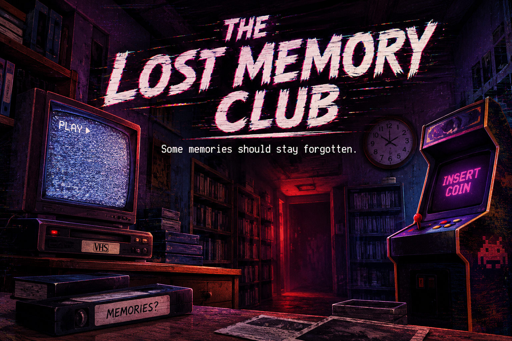

<div align="center">
  

  <h1>THE LOST MEMORY CLUB</h1>
  <p><em>Some memories should stay forgotten.</em></p>
  <p><strong>Kiroween 2026 · Resurrection Category</strong></p>
</div>

> **Development Status: Active Integration on `main`**
>
> The **3D Archive Exploration World (`src/world/**`)** is **complete and merged into `main`** (`1,054` passing automated tests across 34 test suites, `19,988 / 20,000` triangles, 32 procedural textures, and a zero-asset procedural Web Audio engine). The **Haunted Arcade (`src/arcade/`)** and **VHS Narrative & Persistence (`src/memories/`, `src/ui/`)** modules are actively integrating onto this shared `main` foundation.

---

## About the Project (30-Second Overview)

**The Lost Memory Club** is a browser-based 1990s psychological retro-horror mystery built for **Kiroween 2026** (*Resurrection* category), designed for fans of analog horror, retro arcade culture, and narrative exploration games.

**Resurrecting Obsolete 1990s Tech in the Browser:** Players step into a late-night, abandoned VHS and arcade media archive in first person—flipping through physical two-page arcade manuals, spinning eerie vinyl tracks on a working 1990s Hi-Fi turntable, uncovering clues hidden on a cursed VHS tape, and beating a haunted arcade game to witness how recovered memories permanently alter the room around them.

### Why It Stands Out
- **"Scare Me, Then Make It Easy" UX:** Combines unsettling 1990s late-night atmosphere (CRT hum, eerie archive liner notes, flickering attract screens, and dynamic room lighting) with immediate, frictionless controls (`WASD` + 1:1 mouse aim, `E` to inspect, `1–5` turntable track hotkeys, `M` mute toggle, and a live `NOTES READ: X / 7` progress counter).
- **Zero-Asset Procedural Craft:** Every texture (32 procedural canvases), 3D prop, 24 Hz arcade attract screen, and Web Audio synthesizer track/SFX is generated procedurally in code—eliminating external `.glb` or `.mp3` dependencies and ensuring 100% copyright-safe audio.
- **Reusable Open-Source Architecture:** Built with strict module isolation (`src/world/`, `src/arcade/`, `src/memories/`, `src/core/`) under the MIT License so other web developers can reuse the zero-asset Web Audio synth, procedural texture pipeline, and budget-tested React Three Fiber exploration harness.

---

## Built with Kiro

This project was engineered using **Kiro IDE** as the core architectural and verification workflow, with all specifications and steering rules preserved at the root of this repository (`/.kiro`):

- **Spec-Driven Development (`.kiro/specs/`):**
  - `.kiro/specs/game-foundation/` defines the global product requirements, typed station contracts (`StationId = 'vhs' | 'arcade'`), and core state architecture.
  - `.kiro/specs/world-exploration/` documents 36 incremental implementation and verification tasks (`requirements.md`, `design.md`, `tasks.md`, `tasks.meta.json`) alongside automated audit logs (`test-report.md`, `performance-log.md`, `integration-notes.md`). Structuring specs before implementation prevented context drift across 30+ commits while keeping 3D geometry strictly inside performance budgets.
- **Steering & Module Isolation (`.kiro/steering/`):**
  - `architecture.md` and `product.md` enforce strict module boundaries across team areas.
  - `src/world/boundary.test.ts` automatically verifies in CI that `src/world/**` never leaks imports or storage calls into protected modules (`src/core/`, `src/arcade/`, `src/memories/`, `src/ui/`).
- **Budget-Verified Procedural Pipeline:**
  - Automated geometry and memory assertions (`modelDetail.test.ts`, `roomLayout.test.ts`, `targeting.test.ts`) enforce hard budgets on every commit: `19,988 / 20,000` triangles, `403 / 425` grouped draw calls, `4` scene lights, and `32` procedural textures (`7.703 MiB <= 7.85 MB`).

```text
.kiro/
├── specs/
│   ├── game-foundation/          # Core architecture, contracts, and global tasks
│   └── world-exploration/        # 36-task 3D world spec, audit logs, and benchmarks
└── steering/
    ├── architecture.md           # Module isolation & budget rules
    └── product.md                # 1990s analog horror UX & atmosphere direction
```

---

## Visual Preview

### Concept Artwork

The visual identity of **The Lost Memory Club** draws inspiration from late-night 1990s video rental archives, CRT televisions, VHS recordings, Hi-Fi vinyl consoles, and classic arcade cabinets.

*The cover artwork above illustrates the target atmosphere and visual direction of the archive.*

### Implemented Features in the Current `main` Build

- **1990s Archive Room & Lighting (`src/world/scene/`, `src/world/layout/`):** First-person navigation with substep collision detection, frame-rate-independent movement + 1:1 mouse look, interactive desk lamps coupled to scene lighting, and a `?worldPerf=1` runtime overlay.
- **Interactive Clues & Two-Page Arcade Manuals (`src/world/overlay/`):** 7 readable archive documents (`NOTES READ: X / 7`), including illustrated two-page spread manuals (`SNAKE.EXE`, `LAST EXIT`, `DEAD FREQUENCY`) with `1` / `2` page switching.
- **Animated Arcade Cabinets (24 Hz):** Live procedural canvas attract loops running across all 3 arcade machines (automatically pauses while inspecting stations and respects `prefers-reduced-motion`).
- **Two-Tier 1990s Hi-Fi Turntable & Procedural Web Audio (`src/world/audio/`):** Walnut/steel audio console and 3-way floor loudspeaker featuring a 33 1/3 RPM spinning platter, pivoting tonearm, dynamic *NOW PLAYING* LP jacket, 4 selectable procedural 1990s synth tracks + stop (`1`–`5`), needle-drop/VHS/coin/lamp SFX, automatic station panel audio ducking, and `M` mute toggle (`AudioBadge`).

---

## Technology Stack

| Technology | Purpose |
|---|---|
| **Kiro IDE** | Spec-driven architecture (`.kiro/specs/`), steering enforcement (`.kiro/steering/`), and task-by-task implementation |
| **React 18 & TypeScript** | Strict type-safe UI overlays, station routing, and interactive document viewers |
| **Three.js / React Three Fiber** | Real-time 3D archive rendering, procedural materials, and custom prop geometry |
| **HTML5 Canvas (2D)** | 32 procedural textures and 24 Hz animated arcade attract screens |
| **Web Audio API** | Zero-asset procedural 1990s synth soundtrack, vinyl needle-drop, VHS, and arcade SFX |
| **Vitest & GitHub Actions CI** | 1,054+ unit, property, budget, and boundary tests run automatically on push/PR to `main` |
| **Vite** | Fast local development server and optimized production bundling |

---

## Requirements

Before running the project, make sure you have installed:

- **Node.js** `20.19+` (or `22.12+`)
- **npm**

---

## Getting Started

Clone the repository and install dependencies:

```bash
git clone [https://github.com/4nthonyzz/the-lost-memory-club.git](https://github.com/4nthonyzz/the-lost-memory-club.git)
cd the-lost-memory-club
npm install
```

Start the development server:

```bash
npm run dev
```

Open the local URL printed by Vite in your browser (append `?worldPerf=1` to inspect live FPS and scene metrics).

### Controls Quick Reference

- **`W A S D` / Arrow Keys:** Walk through the archive
- **Mouse (Click canvas) / `I J K L`:** Look around
- **`E`:** Inspect CRT TV/VHS, Arcade Cabinets, Clues, Manuals, Lamps, or Turntable
- **`1`–`4` / `5`:** Spin tracks 1–4 or stop the 1990s Hi-Fi turntable
- **`M`:** Toggle procedural Web Audio on/off
- **`Esc`:** Close active inspection overlay

---

## Testing and Validation

Run the full validation suite locally (mirrored by `.github/workflows/ci.yml`):

```bash
# TypeScript type validation
npm run typecheck

# Automated test suite (1,054+ tests across 34 files)
npm test

# Production bundle build
npm run build
```

---

## Project Structure and Team Responsibilities

Development is organized into isolated feature directories coordinated through typed contracts in `src/core/`:

| Feature Area | Directory | Status & Responsibility |
|---|---|---|
| **World & Exploration** | `src/world/` | **Completed & Merged (`main`)** — Developer 1: 3D archive room, first-person controls, collisions, interactive props, procedural textures, and Web Audio engine |
| **Haunted Arcade** | `src/arcade/` | **In Progress** — Developer 2: playable retro horror Snake minigame, scoring, win/loss states, and deterministic rules |
| **VHS, Narrative & UI** | `src/memories/`, `src/ui/` | **In Progress** — Developer 3: VHS tape playback, memory clues, narrative progression, and `LocalStorage` persistence |
| **Shared Core Contracts** | `src/core/` | Shared typed event contracts (`StationId`, reducer state) maintained collaboratively |

For team workflow and branching conventions, see [`docs/TEAM_SETUP.md`](docs/TEAM_SETUP.md).

---

## Security, Originality and Licensing

- **Starter Scaffold Disclosure:** Built upon the initial *The Lost Memory Club* project scaffold (`src/core/` typed contracts and foundation specs); all 3D exploration geometry, procedural textures, Web Audio synthesizer/SFX engine, arcade minigame logic, and VHS narrative systems were created during the Kiroween 2026 submission period.
- **Zero Exposed Secrets:** No API keys, tokens, or credentials are stored in source control, and `.env*` files are excluded via `.gitignore`.
- **`.kiro/` Tracked at Root:** Both `.kiro/specs/` and `.kiro/steering/` remain committed and visible at the repository root.
- **100% Original & Copyright-Safe:** All 3D geometry, textures, UI, and Web Audio synthesis are original code. Third-party dependencies are documented in [`docs/THIRD_PARTY_ASSETS.md`](docs/THIRD_PARTY_ASSETS.md).
- **License:** Released under the **MIT License** (see [`LICENSE`](LICENSE)).

---

## Kiroween 2026 Submission Checklist

- [x] Public GitHub repository (`4nthonyzz/the-lost-memory-club`) with MIT License
- [x] `.kiro/` directory (`specs/` and `steering/`) tracked at repository root
- [x] Complete installation, controls, and automated CI validation (`typecheck`, `test`, `build`)
- [x] 3D exploration world, interactive props, and procedural Web Audio merged into `main`
- [ ] Full integration of Arcade (`src/arcade/`) and VHS Memory playback (`src/memories/`) on `main`
- [ ] Public YouTube demonstration video (< 3 minutes) and deployed build link for Devpost

---

*The Lost Memory Club — Some memories should stay forgotten.*
